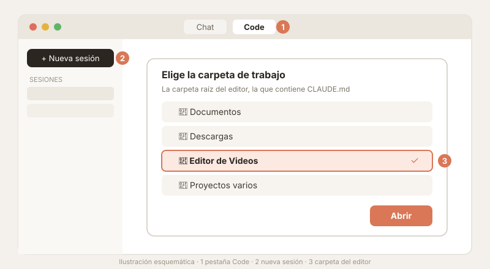
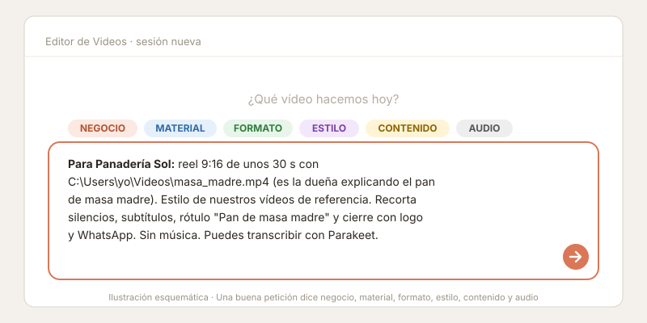
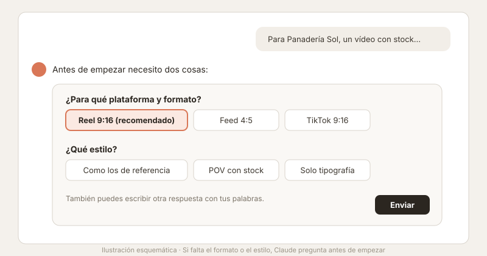
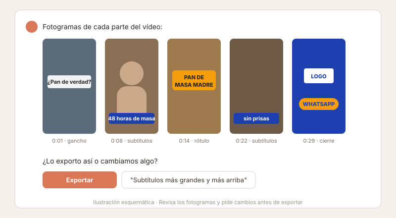
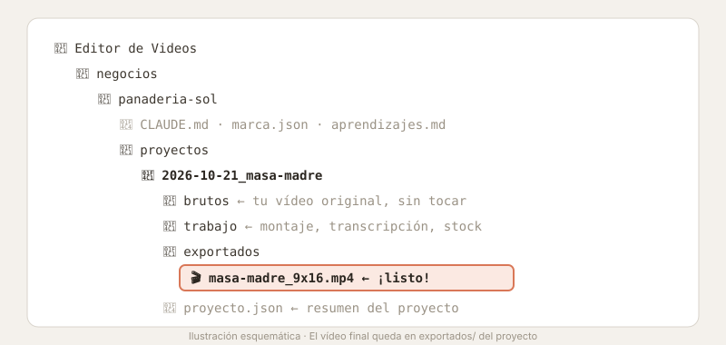

# Manual de uso

Cómo pedirle vídeos al editor desde Claude Code: desde abrir la carpeta hasta tener el MP4 listo para publicar.

> Las imágenes de este manual son **ilustraciones esquemáticas** de cada paso, no capturas reales. La apariencia de Claude Code puede variar según la versión.

**Índice**
1. [Antes de empezar](#1-antes-de-empezar)
2. [Abrir el editor en Claude Code](#2-abrir-el-editor-en-claude-code)
3. [La primera vez: dar de alta un negocio](#3-la-primera-vez-dar-de-alta-un-negocio)
4. [Hacer una petición, paso a paso](#4-hacer-una-petición-paso-a-paso)
5. [El prompt maestro](#5-el-prompt-maestro)
6. [Consejos de formato, contenido y diseño](#6-consejos-de-formato-contenido-y-diseño)
7. [Ejemplos de peticiones](#7-ejemplos-de-peticiones)
8. [Corregir y repetir](#8-corregir-y-repetir)
9. [Costes y privacidad](#9-costes-y-privacidad)
10. [Problemas frecuentes](#10-problemas-frecuentes)

---

## 1. Antes de empezar

Comprueba que tienes lo siguiente:

- [ ] **Claude Code**, en la app de escritorio de Claude (pestaña **Code**) o en la terminal.
- [ ] **El editor instalado.** Si no lo está, sigue el [README](../README.md#instalación): descargar y ejecutar `instalar.ps1` (Windows) o `instalar.sh` (macOS).
- [ ] **La clave de Pixabay** pegada en `~/.claves/editor-videos/pixabay.env` (en Windows, `%USERPROFILE%\.claves\editor-videos\pixabay.env`). Solo hace falta si vas a usar vídeos o imágenes de stock.
- [ ] *(Opcional)* **Voicebox abierto**, si vas a generar locuciones en local. Tiene que estar abierto **antes** de iniciar la sesión de Claude Code.

Para revisar que todo está bien sin instalar nada:

```powershell
powershell -ExecutionPolicy Bypass -File instalar.ps1 -SoloComprobar
```
```bash
bash instalar.sh --solo-comprobar
```

---

## 2. Abrir el editor en Claude Code

Lo único importante es que **la carpeta de trabajo sea la carpeta del editor**, la que contiene `CLAUDE.md`, `herramientas/` y `negocios/`. Es la que hace que Claude lea las reglas, las herramientas, las skills de vídeo y los datos de tus negocios.



### Desde la app de escritorio de Claude
1. Abre la app de Claude y entra en la pestaña **Code**.
2. Empieza una sesión nueva y elige como carpeta de trabajo la del editor (por ejemplo, `Editor de Videos`).
3. Escribe tu petición en el cuadro de mensaje.

### Desde la terminal
```bash
cd "ruta/a/Editor de Videos"
claude
```

### Una sesión por vídeo
No hace falta seguir siempre en la misma conversación. Todo lo importante está en archivos (las reglas, la marca de cada negocio, los aprendizajes), así que cada sesión nueva arranca sabiendo lo mismo. Mejor **una sesión por vídeo o por tarea**: las conversaciones cortas son más rápidas y se equivocan menos.

> Abre siempre la **carpeta raíz** del editor, no la de un negocio. El negocio se lo dices en el mensaje.

---

## 3. La primera vez: dar de alta un negocio

Cada negocio tiene su propia carpeta en `negocios/` con su marca, sus recursos y sus proyectos. Para crear uno:

```
Vamos a crear un negocio nuevo que se llama Panadería Sol.
```

Claude copia `negocios/_plantilla/` a `negocios/panaderia-sol/` y te pide los datos. Cuanto más completo quede, mejores serán los vídeos:

| Qué | Dónde se guarda | Consejo |
| --- | --- | --- |
| A qué se dedica, el público, el tono y qué evitar | `CLAUDE.md` del negocio | Si tienes una guía de marca (PDF, Markdown…), pásasela: la resume y la aplica. |
| Colores, tipografías, logo y subtítulos | `marca.json` | Mejor los códigos exactos (`#1E40AF`). Si no los tienes, los saca del logo. |
| Logos | `marca/logos/` | PNG con fondo transparente, en versión clara **y** oscura. |
| Tipografías | `marca/tipografias/` | Los archivos `.ttf` u `.otf` de cada peso (Bold, Medium…). Hacen falta para escribir texto en el vídeo. |
| Productos, servicios, horarios, precios internos | `informacion/` | PDF, imágenes o texto. Claude los resume en un `.md` para usarlos en los guiones. |
| Vídeos que ya habéis publicado | `referencias/` | Claude los analiza (ritmo, textos, subtítulos, música) y escribe `estilo-de-referencia.md` para mantener ese estilo. |

**Ejemplos:**
```
Te dejo la guía de marca en C:\Users\yo\Descargas\guia.pdf. Rellena el negocio con lo que encuentres y dime lo que falte.
```
```
He copiado 4 vídeos ya publicados en negocios/panaderia-sol/referencias/. Analízalos para que tengas nuestro estilo de referencia.
```

---

## 4. Hacer una petición, paso a paso

### Paso 1: prepara el material (si tienes)
- **Vídeo grabado** (una persona hablando, planos del local…): déjalo donde esté y da la ruta en la petición, o cópialo tú en `negocios/<negocio>/proyectos/AAAA-MM-DD_nombre/brutos/`. El original **nunca se modifica**.
- **Sin material propio:** Claude puede buscar vídeos e imágenes gratuitos en Pixabay o hacer un vídeo solo con texto y gráficos.

### Paso 2: escribe la petición
Indica **el negocio**, **el material** y **qué quieres conseguir**. Lo más cómodo es usar el [prompt maestro](#5-el-prompt-maestro).



### Paso 3: responde a las preguntas
Si falta algo importante, Claude **pregunta antes de empezar**: es una de sus reglas. Lo normal es que pregunte el **formato** (9:16, 4:5…), el **estilo** y el **audio**. Contesta con un clic o escribiendo.



### Paso 4: revisa los fotogramas
Antes de entregar, Claude saca **fotogramas de cada parte** del vídeo y te los enseña. Es el momento de pedir cambios (textos, tamaños, orden) antes de exportar.



### Paso 5: recoge el vídeo
El MP4 final queda en `exportados/` del proyecto, con un `proyecto.json` que resume lo que se hizo (formato, plataforma, material usado…).



---

## 5. El prompt maestro

Copia, rellena lo que sepas y **borra las líneas que no necesites**. No hace falta rellenarlo todo: lo que falte, Claude lo saca de los archivos del negocio o te lo pregunta.

```
NEGOCIO: [nombre del negocio]

MATERIAL:
- [ruta del vídeo grabado, p. ej. C:\Users\yo\Descargas\video.mp4 — qué se ve: quién habla y de qué]
- [o: "sin material propio, busca en Pixabay" / "solo texto y gráficos"]

OBJETIVO: [qué tiene que conseguir: dar a conocer X, llenar plazas de Y, anunciar Z]
PÚBLICO: [a quién va: clientes actuales, padres, jóvenes…] (si no lo dices, usa el del negocio)

FORMATO:
- Plataforma: [Instagram/Facebook Reels · Feed · Stories · TikTok · YouTube]
- Proporción: [9:16 · 4:5 · 1:1 · 16:9]
- Duración: [p. ej. 15 s / unos 30 s / lo que dure el vídeo sin silencios]

ESTILO: [el de nuestros vídeos de referencia / el de la guía de marca / POV con stock / solo tipografía]

CONTENIDO:
- Gancho (primeros 1–2 s): [frase, o "propón tú 3 opciones"]
- Mensaje principal: [una sola idea]
- Datos que deben salir: [producto, edad, horario, precio, dirección…]
- Recortar: [silencios, repeticiones, tropiezos]
- Subtítulos: [sí / no]
- Rótulos o títulos: [nombre del producto, del curso…]
- Extras: [memes, transiciones, zoom en momentos clave…]

CIERRE: [logo / CTA (una sola llamada a la acción) / teléfono / web]

AUDIO: [voz original / sin música, la pongo yo al publicar / con música / locución con Voicebox]

PERMISOS: Puedes transcribir con Parakeet.
```

### Qué aporta cada parte

| Campo | Para qué sirve | Si no lo pones… |
| --- | --- | --- |
| **Negocio** | Carga su marca, sus aprendizajes y su estilo. | Te pregunta para qué negocio es. |
| **Material** | Saber de qué partir. | Te pregunta si hay material o busca stock. |
| **Objetivo** | Elegir el gancho, el mensaje y el CTA adecuados. | Lo deduce del tema. |
| **Formato** | Tamaño, duración y zonas seguras de la plataforma. | **Te lo pregunta** (es una regla). |
| **Estilo** | Tipografías, colores, efectos. | **Te lo pregunta** (es una regla). |
| **Contenido** | Que salgan los datos que importan, bien escritos. | Usa la información del negocio y te la enseña antes. |
| **Cierre** | Una llamada a la acción clara. | Pone logo y contacto según el negocio. |
| **Audio** | Voz, música o silencio. | Te pregunta. |
| **"Puedes transcribir con Parakeet"** | Recortar y subtitular un vídeo hablado necesita transcribirlo. Es gratis y local, pero es IA, así que Claude pregunta antes. | Te lo preguntará antes de transcribir. |

### Versión corta
Para el día a día suele bastar con esto:
```
Para [negocio]: un reel 9:16 de 30 s con el vídeo C:\ruta\video.mp4 (es [quién] hablando de [tema]).
Estilo de nuestros vídeos de referencia. Recorta silencios, subtítulos, título de [producto] y cierre con logo y teléfono.
Sin música. Puedes transcribir con Parakeet.
```

---

## 6. Consejos de formato, contenido y diseño

### Formatos más habituales

| Plataforma | Proporción | Tamaño | Duración recomendada |
| --- | --- | --- | --- |
| Instagram / Facebook Reels, Stories, TikTok, YouTube Shorts | 9:16 | 1080 × 1920 | 15–30 s (hasta 60 s si el contenido lo pide) |
| Feed de Instagram / Facebook | 4:5 | 1080 × 1350 | 15–30 s |
| Feed cuadrado, carruseles | 1:1 | 1080 × 1080 | 10–20 s |
| YouTube, web | 16:9 | 1920 × 1080 | Lo que pida el contenido |

**Zonas seguras en 9:16:** en Reels y TikTok, la parte de abajo (unos 350 px) y la franja derecha quedan tapadas por los botones y el texto de la publicación. Los datos importantes (precio, horario, CTA) tienen que ir en el centro. Claude ya lo tiene en cuenta, pero si ves algo tapado, díselo.

### Contenido que funciona
- **Gancho en el primer segundo.** Una pregunta, una sorpresa o una tensión ("Si tu hijo se aburre en verano…"). Si no se te ocurre, pide: *"propón 3 ganchos"*.
- **Una sola idea por vídeo.** Mejor tres vídeos de un producto cada uno que uno con tres productos.
- **Subtítulos siempre.** La mayoría de la gente ve los vídeos sin sonido.
- **Una sola llamada a la acción**, al final y clara: *"Reserva tu plaza"*, *"Escríbenos por WhatsApp"*.
- **Datos concretos** mejor que adjetivos: "Martes de 17 h a 18:30 h" convence más que "horarios flexibles".
- **Ritmo:** cambia de plano o de texto cada 1–3 s. Los silencios largos hacen que la gente pase al siguiente vídeo.

### Al grabar el vídeo
- Graba **ya en vertical** si el destino es 9:16. Recortar un vídeo horizontal pierde mucha calidad.
- Con **buena luz** de frente (una ventana delante, no detrás) y **micrófono de solapa** si puedes. El audio importa más que la imagen.
- **1080p o 4K a 30 fps.** Deja un segundo de margen al principio y al final de cada toma.
- No pasa nada si te equivocas: repite la frase y sigue. Claude recorta los tropiezos.

### Diseño: lo que conviene tener listo
- **`marca.json` completo:** colores exactos, tipografías y estilo de subtítulos. Es lo que hace que todos los vídeos se parezcan.
- **Logos en versión clara y oscura,** para que siempre haya contraste.
- **Las tipografías en archivo** (`.ttf`/`.otf`). Sin ellas, el texto sale con una fuente genérica.
- **Vídeos de referencia:** la forma más rápida de que Claude copie *vuestro* estilo (subtítulos, títulos, efectos, ritmo).
- **Normas de la marca:** si hay cosas que no se pueden hacer (otras fuentes, ciertos colores, poner precios), que estén en el `CLAUDE.md` del negocio.
- **Un estilo para cada uso.** Si un negocio usa estilos distintos según la pieza (más desenfadado en los reels y más formal en los anuncios), apúntalo en su `CLAUDE.md`.

---

## 7. Ejemplos de peticiones

**Editar un vídeo de una persona hablando**
```
Para Panadería Sol: reel 9:16 de unos 30 s con C:\Users\yo\Videos\masa_madre.mp4
(es la dueña explicando cómo hacen el pan de masa madre). Estilo de nuestros
vídeos de referencia. Recorta silencios, subtítulos, rótulo "Pan de masa madre"
al principio y cierre con logo y "Pide el tuyo por WhatsApp". Sin música.
Puedes transcribir con Parakeet.
```

**Vídeo sin material propio (stock + texto)**
```
Para Panadería Sol: un reel 9:16 de 15 s tipo POV sobre los desayunos del
fin de semana, con vídeos de Pixabay. Enséñame la galería para elegir los clips.
Cierre con horario de sábado y domingo y la dirección. Sin música.
```

**Solo buscar material**
```
Busca en Pixabay vídeos de pan recién hecho, en vertical, para Panadería Sol.
Lo que elija va a recursos/broll.
```

**Varias versiones de una vez**
```
Del último vídeo de Panadería Sol, saca también una versión 4:5 para el feed
y otra 1:1, con los mismos textos.
```

**Analizar el estilo**
```
He añadido 3 vídeos nuevos en referencias/ de Panadería Sol.
Actualiza el estilo de referencia con lo que veas distinto.
```

---

## 8. Corregir y repetir

Pide los cambios con naturalidad. Cuanto más concreto, mejor:

- *"Los subtítulos más grandes y un poco más arriba."*
- *"Quita el segundo 8 al 11, se repite."*
- *"El título en amarillo, no en blanco."*
- *"Cambia el gancho por: …"*
- *"El horario no es ese: los martes son de 17 a 18:30."*

Cada corrección queda apuntada en `negocios/<negocio>/aprendizajes.md` (qué estaba mal y cómo se hace bien). Claude lee ese archivo antes de cada vídeo, así que **no tendrás que repetir la misma corrección**. Puedes abrir el archivo y editarlo tú cuando quieras.

---

## 9. Costes y privacidad

- **Gratis:** la herramienta en sí, HyperFrames, FFmpeg, Pixabay (con su licencia), la transcripción con Parakeet y las voces de Voicebox. Todo lo local funciona en tu equipo y no envía nada fuera.
- **De pago (opcional):** servicios externos de IA como ElevenLabs. Antes de usar **cualquier** IA, Claude te dice el coste estimado y espera tu confirmación. Si no quieres que use servicios de pago, díselo y lo evitará.
- **Claves:** viven **fuera** de la carpeta del proyecto (`~/.claves/editor-videos/`). Claude tiene prohibido leerlas o mostrarlas.
- **Tus negocios no se comparten:** si actualizas el editor desde GitHub o subes cambios a tu propio repositorio, el `.gitignore` funciona como lista blanca y deja fuera `negocios/<tu-negocio>/`.
- **Permisos de imagen:** si aparecen personas (sobre todo menores), asegúrate de tener su autorización antes de publicar.

---

## 10. Problemas frecuentes

| Problema | Solución |
| --- | --- |
| Claude no conoce las reglas ni los negocios | Has abierto otra carpeta. Abre la **raíz** del editor (la que tiene `CLAUDE.md`). |
| "No se encuentra la clave de Pixabay" o "PIXABAY_API_KEY está vacía" | Abre `~/.claves/editor-videos/pixabay.env`, pega la clave después de `=` y guarda. |
| Voicebox no aparece o "no conecta" | Abre Voicebox **antes** de iniciar la sesión de Claude Code y empieza una sesión nueva. |
| `npx hyperframes` falla dentro de un proyecto | El `package.json` del proyecto se llama `hyperframes`. Claude debería renombrarlo; si no lo hace, pídeselo. |
| El texto no aparece o FFmpeg se cierra al escribir texto | Falta la ruta de la fuente (`fontfile`). Comprueba que el negocio tiene sus `.ttf` en `marca/tipografias/`. |
| El render es lento o falla | Cierra programas que consuman memoria. Los vídeos 4K tardan bastante más que los de 1080p. |
| El vídeo sale sin música | Es normal si lo pediste así. Muchos negocios prefieren añadirla al publicar, con la biblioteca de Instagram o TikTok. |
| Claude repite un error que ya corregiste | Revisa `aprendizajes.md` del negocio y comprueba que la corrección está bien escrita. Si no, añádela tú. |

¿Algo que no esté aquí? Pregúntale directamente a Claude dentro del editor: *"¿Cómo hago para…?"*
